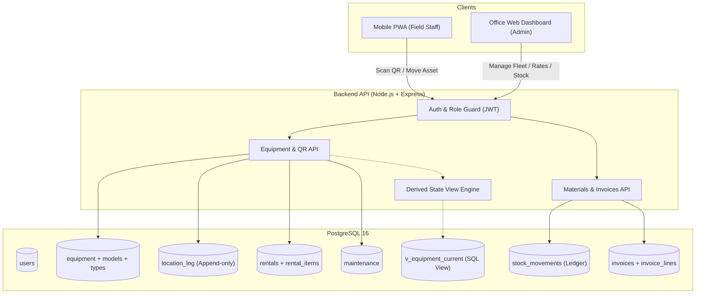

# SPACE EXSPACE Equipment & Materials Tracker — Architecture

## 1. System Overview
SPACE EXSPACE (Dammam, Saudi Arabia) operates an equipment rental and industrial services fleet (crane rental, containers, portable offices, diesel generators, cleaning machinery) alongside materials inventory (metal sheets, conduits, wires, paints) and invoice tracking.

This system provides:
- **Mobile PWA** for yard and field technicians: Scan QR code on physical assets, view specifications, and execute physical state changes (move, dispatch, return, send to repair).
- **Web Dashboard** for office administrators: Full fleet visibility, rate cards, active rentals, material stock levels, and historical invoice material price tracking.
- **REST API Backend**: High-reliability Node.js + TypeScript service backed by PostgreSQL 16.



## 2. Directory Structure
```text
/
├── backend/
│   ├── src/
│   │   ├── config/          # Validated environment configuration (Zod)
│   │   ├── db/              # PostgreSQL pool & connection management
│   │   ├── utils/           # Structured logging (Pino) & helpers
│   │   ├── app.ts           # Express application & middleware chain
│   │   └── server.ts        # Server entrypoint with graceful shutdown
│   ├── migrations/          # Plain SQL migrations (node-pg-migrate)
│   ├── .env.example
│   ├── package.json
│   └── tsconfig.json
├── frontend/                # Mobile-first Vite + React + TypeScript PWA
├── docs/
│   ├── decisions/           # Architectural Decision Records (ADRs)
│   ├── ARCHITECTURE.md      # System architecture & ER diagram
│   ├── LEARNING_LOG.md      # Step-by-step educational log
│   ├── OPEN_QUESTIONS.md    # Unconfirmed client requirements
│   ├── DEMO.md              # 5-7 minute client walkthrough script
│   └── INTERVIEW_QA.md      # 25 core technical interview questions
├── docker-compose.yml       # PostgreSQL 16 container definition
└── README.md                # Quickstart and run instructions
```

## 3. Core Architectural Principles
1. **Derived State Over Stored State**: Physical equipment status (`available`, `rented`, `under_repair`) is derived dynamically in a SQL View (`v_equipment_current`) from immutable action records rather than mutable status columns.
2. **Append-Only Ledgers**:
   - Location tracking is stored as an immutable audit trail in `location_log`.
   - Materials inventory is stored as an immutable double-entry ledger in `stock_movements`.
3. **No ORM (Raw Parameterised SQL)**: Direct SQL allows explicit control over partial indexes, CHECK constraints, multi-table transactions, and database views without leaky abstraction layers.
4. **Defense in Depth**: Role boundaries (Admin vs Staff) are enforced server-side via data serialization guards, ensuring sensitive financial rates are never sent over the wire to unauthorized staff.
